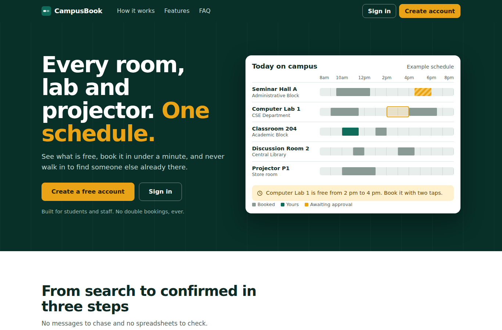
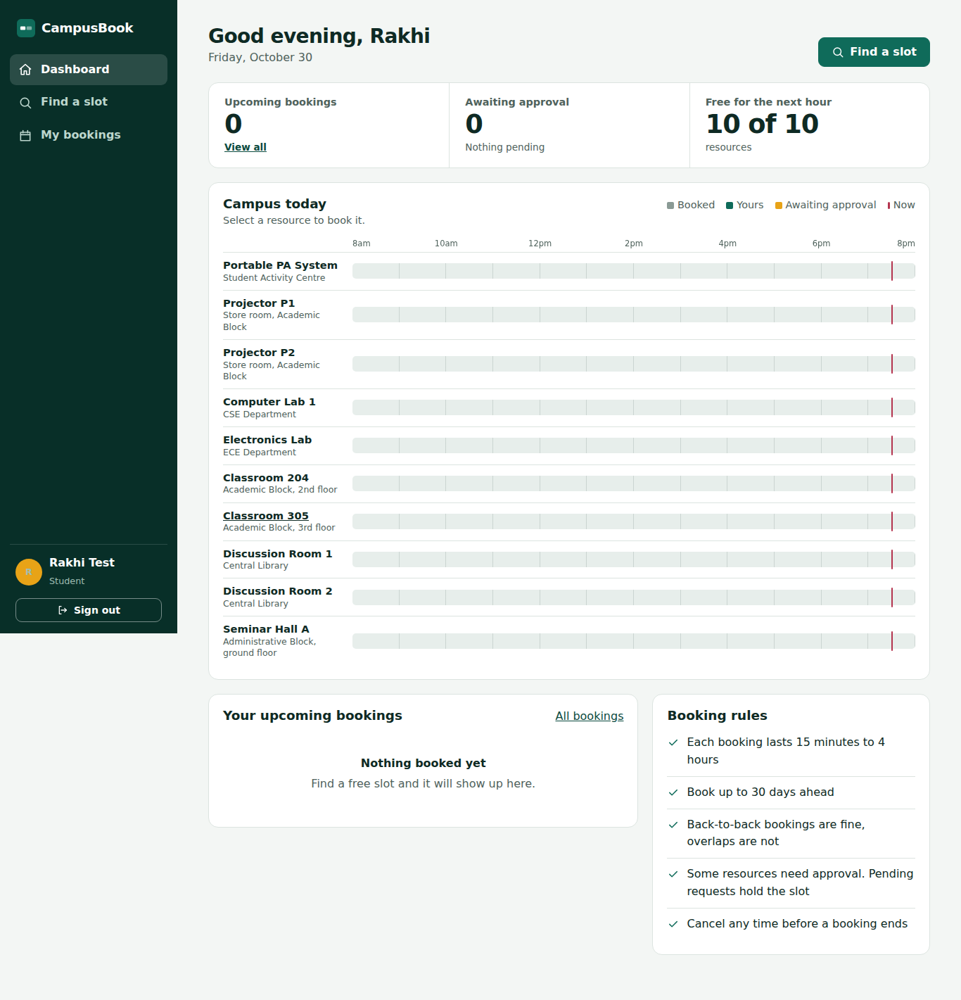
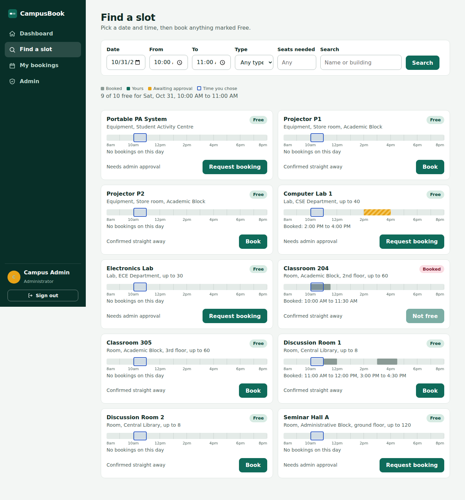
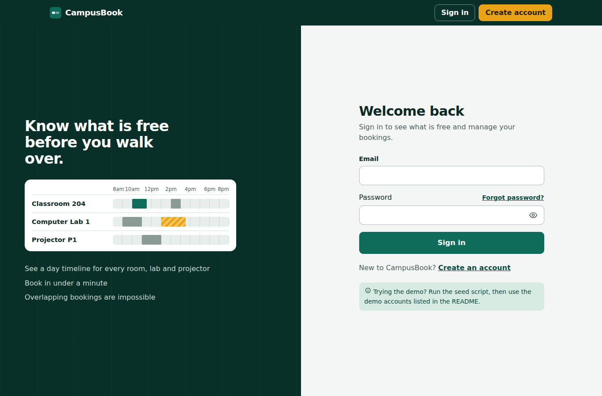
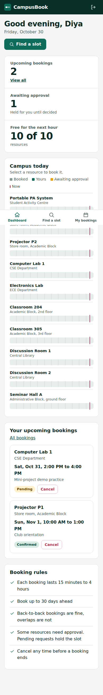

# CampusBook

A REST API and web app for booking campus rooms, labs and equipment. Its main job is to make double-booking impossible, even when two people try to book the same slot at the same moment.

Built for the COSMOS JEC Backend Development project, option BD-01 (Campus Resource Booking API).



## Features

- Public home page that explains the service, with how it works, features, booking rules and an FAQ.
- Sign up and sign in with JWT authentication. Two roles: student and admin. Passwords can be shown or hidden, and a checklist guides new passwords.
- Forgot password: a one-time, expiring OTP sent by email (printed in the server terminal when SMTP is not configured).
- Resource catalogue (rooms, labs, equipment) with location, capacity and an optional approval requirement.
- Availability search by date, time range, type, seats needed and free text. Each result shows a day timeline with the busy slots.
- Booking lifecycle: `pending` or `confirmed` on creation, then `cancelled` or `rejected`. Admins approve or reject requests.
- Students see and manage only their own bookings. Admins manage resources and decide on requests.
- Booking history with status filters, upcoming view and pagination.
- Overlap protection at three levels: a pre-check for a friendly message, an exclusive transaction, and a database trigger.
- Web UI: dashboard with a live "Campus today" board, find a slot, my bookings, admin console. Sidebar layout on laptops, bottom tab bar on phones. Loading, error, empty and success states throughout.

## Screenshots

| Dashboard | Find a slot |
|---|---|
|  |  |

| Sign in | Mobile dashboard |
|---|---|
|  |  |

## Tech stack

| Part | Choice |
|---|---|
| Runtime | Node.js 22.13 or newer |
| Backend | Plain Node `http` with a small router, no framework |
| Database | SQLite through the built-in `node:sqlite` module |
| Auth | Scrypt password hashing, HS256 JWT, both from `node:crypto` |
| Email | Nodemailer over configurable SMTP for password-reset OTPs |
| Frontend | HTML, CSS and ES modules, no build step |
| Tests | Built-in `node:test` runner |

The app uses one small npm dependency for SMTP email; install it with `npm install`. Everything else uses Node.js built-ins. See [docs/DESIGN.md](docs/DESIGN.md) for the architecture.

## Getting started

Prerequisite: Node.js 22.13 or newer (`node -v` to check). Download it free from nodejs.org.

```bash
git clone <your-repo-url>
cd campus-resource-booking

cp .env.example .env
npm install
npm run seed                # creates data/campus.db with demo data
npm start                   # http://localhost:3000
```

On Windows, use `copy .env.example .env` instead of `cp`. For actual OTP emails, edit `.env` and set `SMTP_HOST=smtp.gmail.com`, `SMTP_PORT=587`, `SMTP_SECURE=false`, `SMTP_USER` to your Gmail address, and `SMTP_PASS` to a Google App Password. Set `SMTP_FROM` to your Gmail address too. Google requires 2-Step Verification to create an App Password; never use or share your normal Gmail password. Restart the server after changing `.env`.

Demo accounts created by the seed script (synthetic data, password from `SEED_PASSWORD`, default `Demo@12345`):

| Role | Email |
|---|---|
| Admin | admin@campus.test |
| Student | aarav@campus.test, diya@campus.test, rohan@campus.test |

`npm run seed:reset` wipes the database and seeds it again. `npm run dev` restarts the server on file changes.

## Configuration

Set these in `.env` or as environment variables.

| Variable | Default | Meaning |
|---|---|---|
| `PORT` | `3000` | HTTP port |
| `DB_PATH` | `data/campus.db` | SQLite file location |
| `JWT_SECRET` | dev placeholder | Signing key. Must be 32+ characters when `NODE_ENV=production` |
| `TOKEN_TTL_HOURS` | `8` | How long a sign-in lasts |
| `RESET_CODE_MINUTES` | `30` | How long a password reset code stays valid |
| `SMTP_HOST` | empty | SMTP server hostname (e.g. `smtp.gmail.com`) |
| `SMTP_PORT` | `587` | SMTP server port (`465` for implicit TLS) |
| `SMTP_SECURE` | `false` | Use implicit TLS (`true` for port 465) |
| `SMTP_USER` | empty | SMTP account username |
| `SMTP_PASS` | empty | SMTP account password or app password |
| `SMTP_FROM` | `SMTP_USER` | Sender email address |
| `BOOKING_MAX_DAYS_AHEAD` | `30` | Furthest ahead a booking can start |
| `BOOKING_MIN_MINUTES` | `15` | Shortest booking |
| `BOOKING_MAX_MINUTES` | `240` | Longest booking |
| `SEED_PASSWORD` | `Demo@12345` | Password for demo accounts (demo data only) |

## Running the tests

```bash
npm test
```

The suite has 62 tests covering authentication, password reset, validation, permissions, every overlap shape, adjacent slots, idempotent cancel and approve, pagination, and concurrency. Each run uses a temporary database, so your data is never touched.

| What is checked | Where |
|---|---|
| Registration, login, lockout, token tampering, error format | `test/auth.test.js` |
| Forgot and reset password: single use, expiry, no account enumeration | `test/password-reset.test.js` |
| Resource CRUD, filters, availability, deactivation, privacy of the schedule | `test/resources.test.js` |
| Booking rules, permissions, status changes, listing, double-booking | `test/bookings.test.js` |

## How double-booking is prevented

1. **Validation.** Times must be real ISO 8601 timestamps with a timezone, in the future, inside the booking window, with an allowed length.
2. **Overlap rule.** Two bookings clash when `new.start < existing.end AND new.end > existing.start`. Because both comparisons are strict, a booking that starts exactly when another ends is allowed. Only `pending` and `confirmed` bookings count.
3. **Exclusive transaction.** Creating a booking runs inside `BEGIN IMMEDIATE`. That takes the database write lock before the availability check, so two requests cannot both see the slot as free.
4. **Database trigger.** Even if the application code were wrong, or someone inserted rows directly, a trigger in `src/schema.sql` aborts any insert or update that would create an overlap. A test uses a second database connection to prove this.

A test fires 12 simultaneous requests for one slot and checks that exactly one succeeds and eleven get `409 Conflict`.

## API overview

All endpoints are under `/api` and return JSON. Protected routes need `Authorization: Bearer <token>`. Full request and response examples are in [docs/API.md](docs/API.md), and `requests.http` can be run from VS Code with the REST Client extension.

| Method and path | Who | Purpose |
|---|---|---|
| `POST /auth/register` | public | Create a student account |
| `POST /auth/login` | public | Sign in |
| `POST /auth/forgot-password` | public | Request a password reset OTP by email |
| `POST /auth/reset-password` | public | Set a new password with an emailed OTP |
| `GET /auth/me` | signed in | Current user |
| `GET /config` | public | Booking rules, used by the UI for client-side checks |
| `GET /resources` | signed in | List and search, with availability for a time range |
| `GET /resources/:id` | signed in | One resource |
| `POST /resources` | admin | Add a resource |
| `PATCH /resources/:id` | admin | Edit or reactivate |
| `DELETE /resources/:id` | admin | Deactivate (soft delete) |
| `GET /schedule` | signed in | Busy slots for a time window, without names |
| `POST /bookings` | signed in | Create a booking |
| `GET /bookings` | signed in | Own bookings, or all with `scope=all` for admins |
| `GET /bookings/:id` | owner or admin | One booking |
| `POST /bookings/:id/cancel` | owner or admin | Cancel |
| `POST /bookings/:id/approve` | admin | Approve a pending request |
| `POST /bookings/:id/reject` | admin | Reject a pending request |

Errors share one shape and never include stack traces:

```json
{ "error": { "code": "booking_conflict", "message": "This resource is already booked for part of that time",
  "details": { "conflicting_slot": { "start_time": "...", "end_time": "..." } } } }
```

| Status | Used for |
|---|---|
| 400 | Validation errors (`details` lists each field) |
| 401 | Missing, invalid or expired token, wrong credentials |
| 403 | Signed in but not allowed |
| 404 | Unknown resource or booking |
| 409 | Overlap, inactive resource, impossible status change |
| 429 | Too many failed sign-ins |

## Project structure

```
src/
  server.js        starts the server
  app.js           HTTP handling, static files, error handling
  config.js        environment-based settings
  db.js            opens SQLite, transaction helper
  schema.sql       tables, indexes and the overlap trigger
  seed.js          demo data
  middleware.js    authenticate, requireAdmin
  lib/             router, validation, auth helpers, rate limiter
  services/        business rules (users, resources, bookings), mailer
  routes/          thin HTTP layer
public/            the web UI (index.html, css/, js/)
test/              automated tests
docs/              API, database and design notes, screenshots
```

## Database

Four tables: `users`, `resources`, `bookings` and `password_resets`. The ER diagram and column notes are in [docs/DATABASE.md](docs/DATABASE.md).

## Known limitations

- SQLite allows one writer at a time. That makes the booking check simple and safe, but it will not scale across many servers. Moving to PostgreSQL would use an exclusion constraint (`EXCLUDE USING gist`) for the same guarantee.
- Password reset email uses SMTP when `SMTP_HOST`, `SMTP_USER` and `SMTP_PASS` are configured. Without SMTP, the one-time code is printed in the server terminal for local demos. For Gmail, use an app password rather than your normal account password.
- Signing in on other devices is not cancelled when a password is reset. Existing tokens simply expire after `TOKEN_TTL_HOURS`.
- The login rate limiter lives in memory, so it resets on restart and is per process.
- Tokens are stored in `sessionStorage`, so signing in is per browser tab. There is no refresh token.
- No email or push notifications. Students check My bookings for decisions.
- Deactivating a resource does not cancel its existing bookings. Admins can cancel them one by one.
- Times are stored in UTC and shown in the browser's local timezone.
- Admin accounts come only from the seed script or a direct database change. New sign-ups are always students, and there is no screen for promoting a user.

## Possible next steps

- Waitlist for taken slots, promoting the next request after a cancellation.
- Recurring bookings and bulk cancellation when a resource closes.
- Email notifications through a mock provider.

## Licence

MIT, see [LICENSE](LICENSE).
