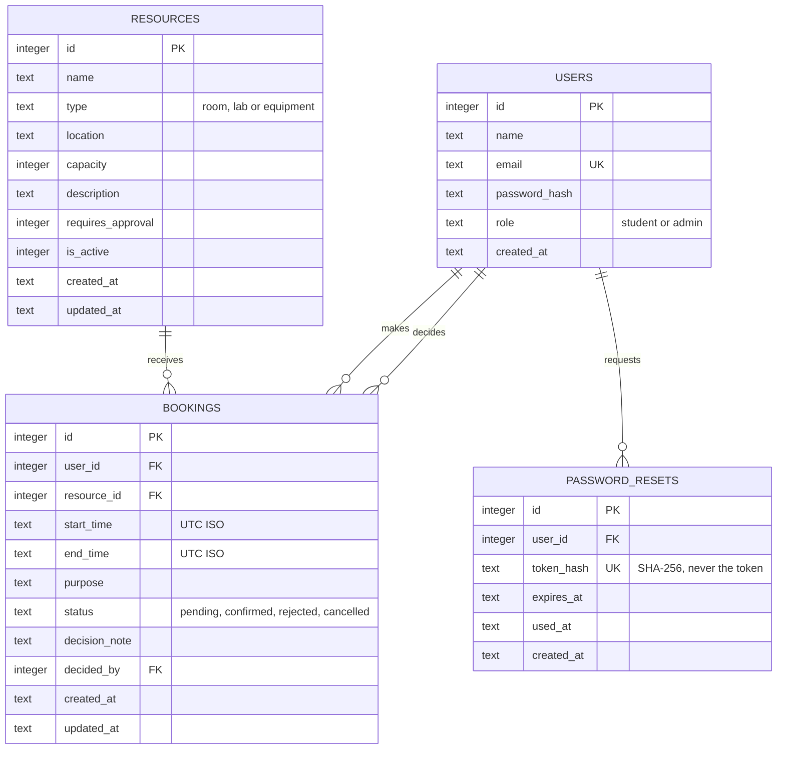

# Database design

SQLite, created from [`src/schema.sql`](../src/schema.sql) when the server starts. Foreign keys are switched on for every connection.



`decided_by` points at the admin who approved, rejected or cancelled a booking.

## Integrity rules in the schema

| Rule | How it is enforced |
|---|---|
| One account per email, case-insensitive | `UNIQUE` on `email` with `COLLATE NOCASE` |
| Only valid roles, types and statuses | `CHECK` constraints |
| Capacity is positive | `CHECK (capacity > 0)` |
| A booking ends after it starts | `CHECK (end_time > start_time)` |
| No duplicate resource at one location | `UNIQUE (name, location)` |
| Bookings always point at real users and resources | Foreign keys |
| No two active bookings overlap on a resource | `BEFORE INSERT` and `BEFORE UPDATE` triggers |
| History is kept when a resource is retired | Soft delete through `is_active` |

## Why timestamps are text

Every time is stored as a UTC string in the fixed form `2026-11-03T09:00:00.000Z`. Strings of the same length and format sort and compare in time order, so the overlap query can compare them directly and use the index on `(resource_id, start_time, end_time)`. The API normalises every incoming value to this form before it reaches the database.

## The overlap trigger

```sql
SELECT RAISE(ABORT, 'booking_overlap')
WHERE EXISTS (
  SELECT 1 FROM bookings b
  WHERE b.resource_id = NEW.resource_id
    AND b.status IN ('pending', 'confirmed')
    AND b.start_time < NEW.end_time
    AND b.end_time   > NEW.start_time
);
```

Cancelled and rejected bookings do not block anything, so a cancelled slot can be booked again immediately. A second trigger runs the same check when a status, time or resource changes on an existing row.

## Indexes

- `idx_bookings_resource_time` on `(resource_id, start_time, end_time)` for overlap checks and schedules.
- `idx_bookings_user_time` on `(user_id, start_time)` for "my bookings".
- `idx_bookings_status` on `(status)` for the admin request queue.

## Sample data

`npm run seed` creates one admin, three students, ten resources (rooms, labs and equipment) and eight bookings in the coming days. All of it is synthetic.
